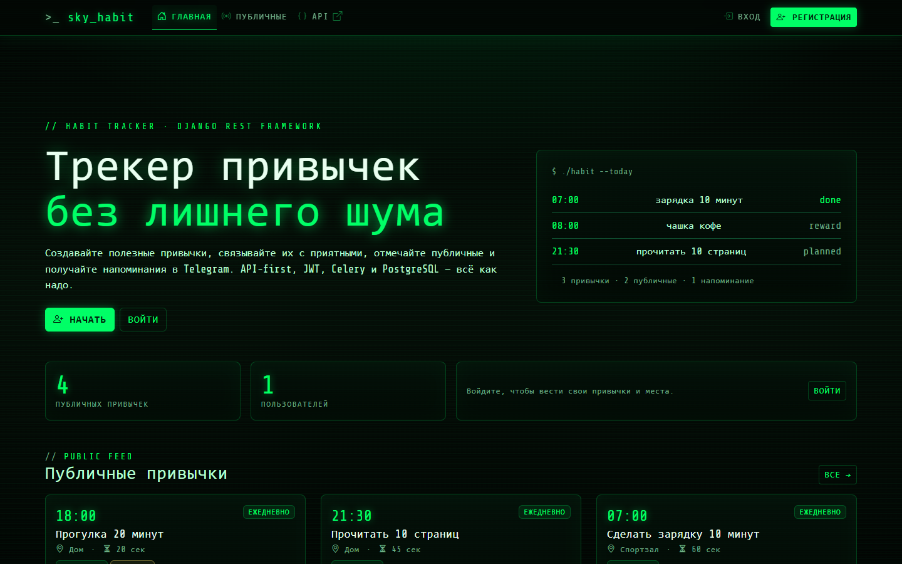
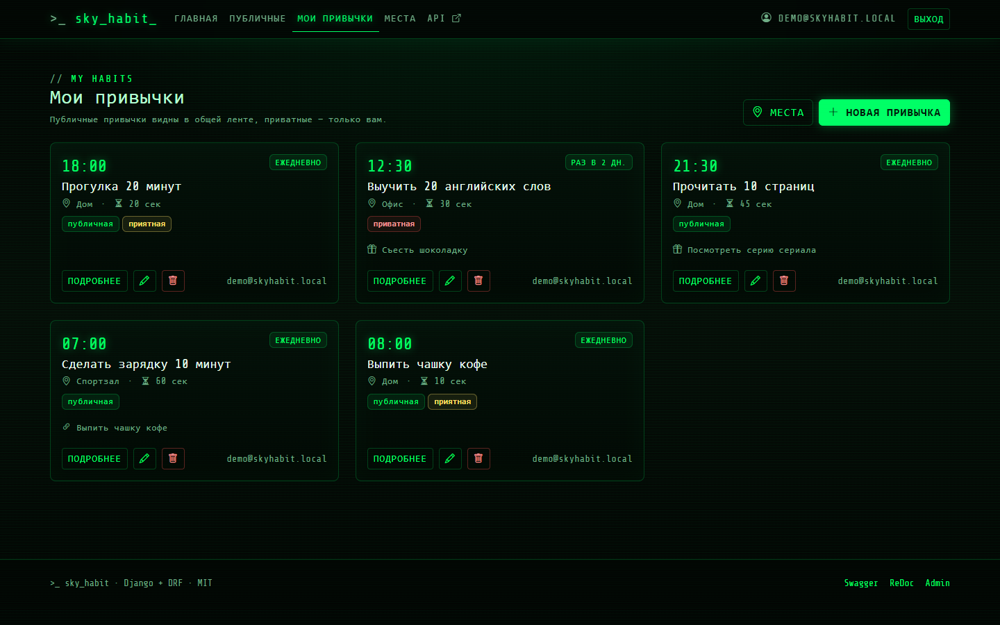
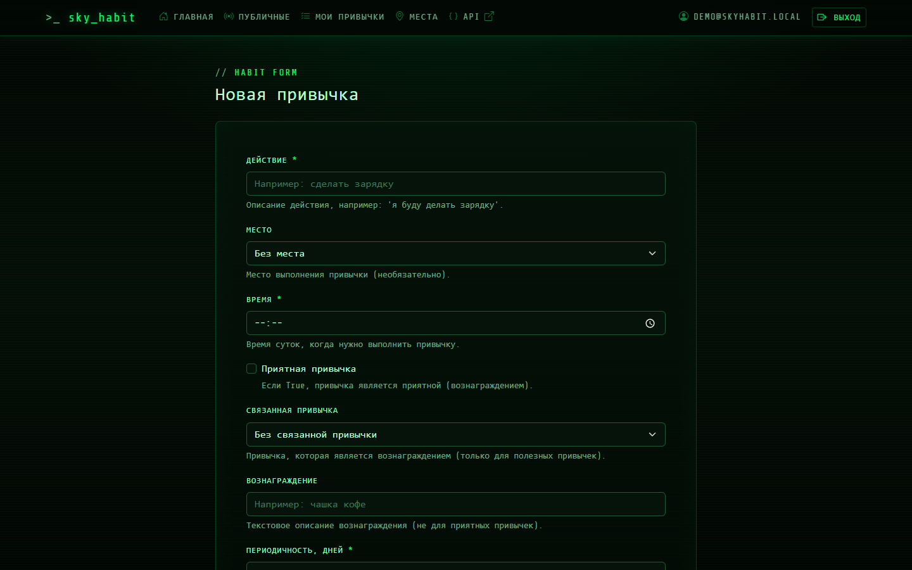
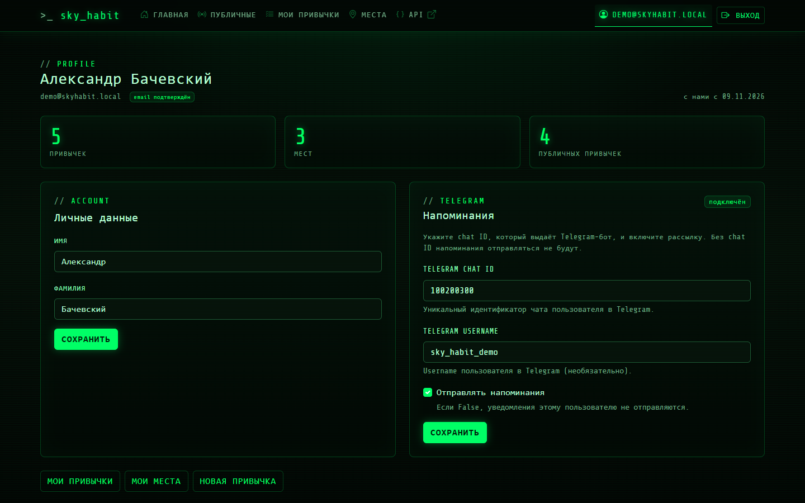
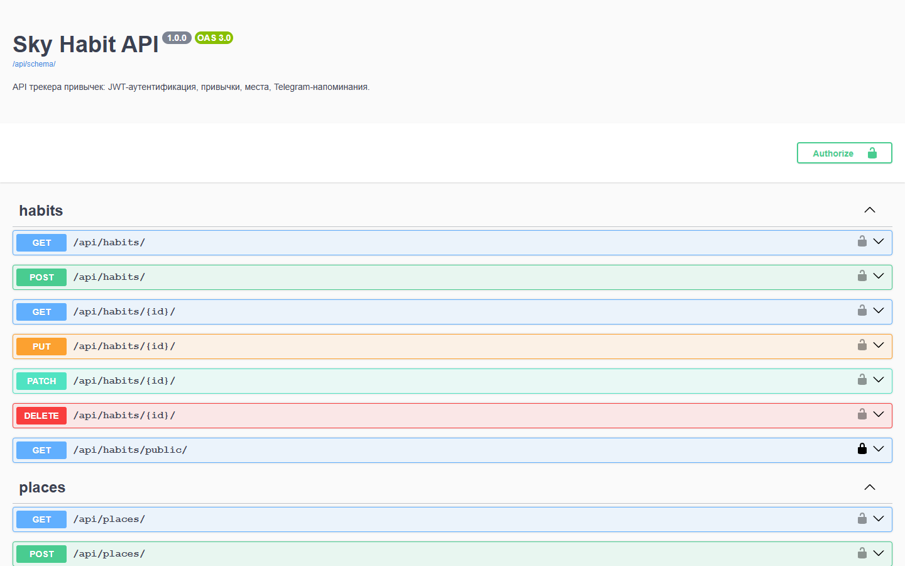
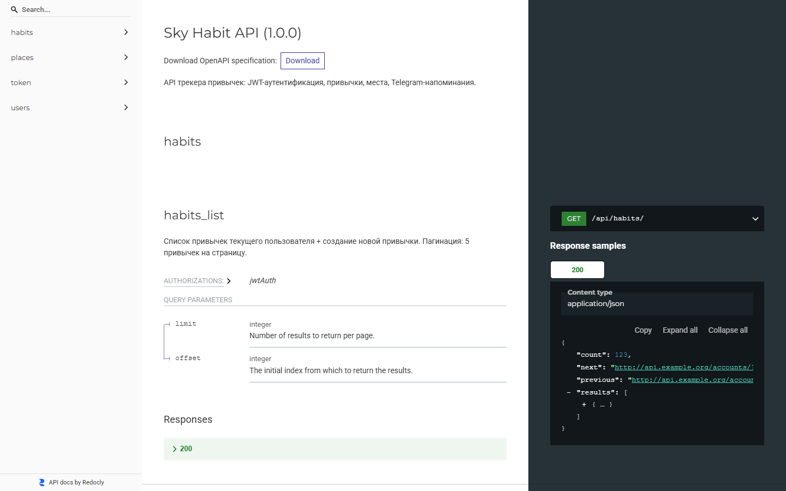
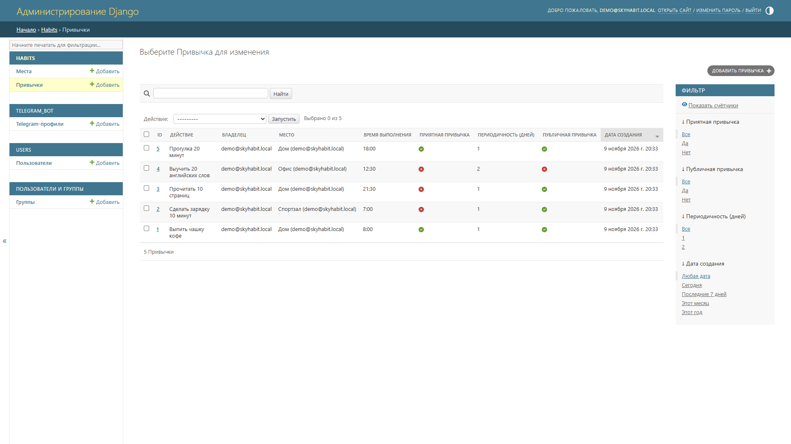
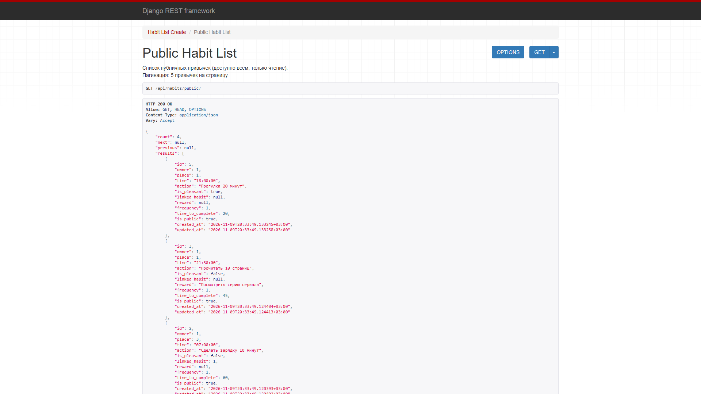
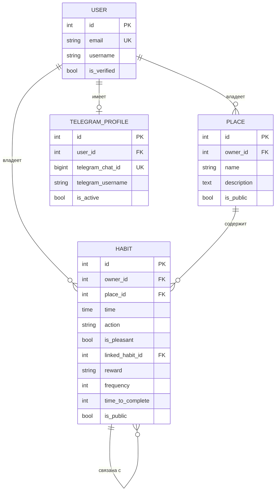

# Sky Habit — трекер привычек

[](https://github.com/Alex-399745146/sky_habit/actions/workflows/ci.yaml)
[](#тесты-и-покрытие)
[](https://www.python.org/)
[](https://www.djangoproject.com/)
[](LICENSE)

Backend и веб-интерфейс трекера привычек на Django REST Framework с JWT-аутентификацией,
напоминаниями в Telegram и фоновыми задачами Celery.

Сервис позволяет регистрироваться, создавать привычки и места их выполнения,
отмечать привычки публичными, связывать полезную привычку с приятной
и получать ежедневные напоминания в Telegram. Веб-интерфейс оформлен
в тёмной Matrix-теме на Bootstrap 5.

## Стек

- Python 3.13, Django 6.0, Django REST Framework 3.17
- JWT (`djangorestframework-simplejwt`), OpenAPI (`drf-spectacular`)
- PostgreSQL 16, Redis 6
- Celery + Celery Beat
- Telegram Bot API (`python-telegram-bot`)
- Bootstrap 5 (CDN), Matrix-тема, Django templates
- Docker Compose, Nginx, Gunicorn
- Poetry, pytest, flake8, black, isort, mypy
- GitHub Actions (CI + ручной деплой)

## Возможности

- Регистрация, вход по email и JWT-аутентификация.
- Подтверждение email по одноразовой ссылке (токен в БД, срок 24 часа).
- Сброс пароля через API (в dev-режиме письмо сохраняется в `tmp/emails/`).
- CRUD привычек и мест выполнения.
- Публичные и приватные привычки, отдельная лента публичных привычек.
- Полезные и приятные привычки, связанные привычки и вознаграждения.
- Валидация бизнес-правил на уровне моделей и сериализаторов.
- Ежедневные напоминания в Telegram через Celery Beat.
- Swagger UI, ReDoc и OpenAPI-схема.
- Веб-интерфейс: главная, CRUD привычек и мест, профиль, вход и регистрация.
- Автотесты, линтеры, проверка типов и сборка Docker-образов в CI.

## Скриншоты

### Веб-интерфейс









### API и админка









## Быстрый старт

### 1. Клонирование

```bash
git clone https://github.com/Alex-399745146/sky_habit.git
cd sky_habit
```

### 2. Переменные окружения

```bash
cp .env.example .env
```

Шаблон `.env.example` содержит рабочие значения для запуска через Docker Compose.
При необходимости измените пароль PostgreSQL и `SECRET_KEY`. Файл `.env` не должен
попадать в Git.

> Если вы запускаете Django и Celery на хосте, а PostgreSQL и Redis — в Docker,
> замените `DB_HOST=db` на `localhost`, `DB_PORT=5432` на `5433`,
> а адреса `redis://redis:6379/0` — на `redis://localhost:6380/0`.

### 3. Запуск в Docker

```bash
docker compose up -d --build
docker compose ps
```

Приложение будет доступно по адресу `http://localhost/`.

Остановка:

```bash
docker compose down          # контейнеры
docker compose down -v       # контейнеры и данные PostgreSQL
```

> `docker compose down -v` удаляет данные базы. Используйте только если они больше не нужны.

### 4. Локальный запуск без Docker

Для разработки без Docker и PostgreSQL есть отдельные настройки на SQLite:

```bash
poetry install --with dev
poetry run python manage.py migrate --settings=config.settings_local
poetry run python manage.py createsuperuser --settings=config.settings_local
poetry run python manage.py runserver --settings=config.settings_local
```

`config.settings_local.py` использует файл `db_local.sqlite3`, eager-режим Celery
и выводит письма в консоль. Docker, PostgreSQL и Redis не нужны.

Тесты без Docker:

```bash
poetry run pytest --ds=config.settings_test
```

`config.settings_test.py` использует SQLite в памяти и не требует PostgreSQL,
Redis или Docker.

### 5. Настройка почты

По умолчанию используется консольный backend: письмо печатается в терминал,
реальная отправка не выполняется. Для реальной отправки добавьте в `.env`:

```dotenv
SITE_URL=http://127.0.0.1:8000
EMAIL_BACKEND=django.core.mail.backends.smtp.EmailBackend
EMAIL_HOST=smtp.yandex.ru
EMAIL_PORT=465
EMAIL_USE_SSL=True
EMAIL_USE_TLS=False
EMAIL_HOST_USER=your@yandex.ru
EMAIL_HOST_PASSWORD=app-password
DEFAULT_FROM_EMAIL=Sky Habit <your@yandex.ru>
```

`EMAIL_HOST_PASSWORD` — пароль приложения почтового провайдера, а не обычный
пароль аккаунта. Для Mail.ru: `smtp.mail.ru`, порт 465, SSL. Для Gmail:
`smtp.gmail.com`, порт 587, TLS.

Проверка отправки:

```bash
poetry run python manage.py sendtestemail your@yandex.ru --settings=config.settings_local
```

После регистрации письмо содержит ссылку `/verify/<token>/`, действует 24 часа.
Если письмо потерялось, его можно отправить повторно из профиля.

### 6. Миграции и суперпользователь

```bash
docker compose exec backend python manage.py migrate
docker compose exec backend python manage.py createsuperuser
```

## Веб-интерфейс

Корень `/` — главная страница с публичной лентой. Веб-интерфейс использует
Django-сессии (вход по email), а API — JWT.

| Маршрут | Назначение |
|---|---|
| `GET /` | Главная и публичная лента |
| `GET /public/` | Все публичные привычки |
| `GET /habits/` | Мои привычки |
| `GET/POST /habits/new/` | Создание привычки |
| `GET /habits/<id>/` | Детальная страница |
| `GET/POST /habits/<id>/edit/` | Редактирование |
| `POST /habits/<id>/delete/` | Удаление |
| `GET/POST /places/...` | CRUD мест |
| `GET/POST /profile/` | Профиль и Telegram-настройки |
| `GET /verify/<token>/` | Подтверждение email по ссылке из письма |
| `POST /verify/resend/` | Повторная отправка письма из профиля |
| `GET/POST /login/`, `/register/` | Вход и регистрация |

## API

| Маршрут | Назначение |
|---|---|
| `GET /api/schema/` | OpenAPI-схема |
| `GET /api/docs/` | Swagger UI |
| `GET /api/redoc/` | ReDoc |
| `POST /api/users/register/` | Регистрация |
| `GET /api/users/verify/<token>/` | Подтверждение email |
| `POST /api/users/password-reset/` | Запрос сброса пароля |
| `POST /api/users/password-reset-confirm/<uid>/<token>/` | Сброс пароля |
| `POST /api/token/` | Получение JWT |
| `POST /api/token/refresh/` | Обновление JWT |
| `GET/POST /api/habits/` | Список и создание привычек |
| `GET/PATCH/DELETE /api/habits/<id>/` | Работа с привычкой |
| `GET /api/habits/public/` | Публичные привычки |
| `GET/POST /api/places/` | Список и создание мест |
| `GET/PATCH/DELETE /api/places/<id>/` | Работа с местом |

Административная панель: `http://localhost/admin/`.

## Схема данных



## Тесты и покрытие

```bash
# без Docker, SQLite в памяти
poetry run pytest --ds=config.settings_test

# с PostgreSQL и Redis из Docker
docker compose up -d db redis
poetry run pytest
```

Текущее состояние: **72 теста, покрытие 87%** (измерено `pytest-cov`).
Тесты находятся в `habits/tests.py`, `users/tests.py` и `telegram_bot/tests.py`.

## Линтеры и типы

```bash
poetry run flake8 .
poetry run black --check .
poetry run isort --check-only .
poetry run mypy .
```

## CI

Workflow: `.github/workflows/ci.yaml`.

При `push`, `pull_request` и ручном запуске выполняются:

- Django system check;
- pytest;
- flake8, black, isort, mypy;
- сборка Docker-образов.

CI поднимает собственные PostgreSQL 16 и Redis 6, production-секреты не нужны.

## Деплой

Деплой вынесен в отдельный job и запускается **только вручную** через
`workflow_dispatch`. Это сделано осознанно: публичная демо-VM сейчас не
поддерживается, а автоматический деплой при каждом push делал бы CI красным
без работающего сервера.

GitHub Actions выполняет:

1. Проверку наличия обязательных secrets.
2. Подключение к VM по SSH.
3. `git pull --ff-only origin main` в `~/apps/sky_habit`.
4. Создание `.env` на VM.
5. `docker compose up -d --build --remove-orphans`.

Для запуска деплоя нужны secrets: `SERVER_HOST`, `SERVER_PORT`, `SERVER_USER`,
`SERVER_SSH_KEY`, `SECRET_KEY`, `DB_PASSWORD`, `TELEGRAM_BOT_TOKEN`.
Если сервер не настроен, деплой завершится понятной ошибкой на шаге проверки secrets.

## Структура проекта

```text
sky_habit/
├── config/              # настройки, URL, Celery, WSGI
├── users/               # пользователь, JWT, email, вход и регистрация
├── habits/              # привычки, места, API и веб-views
├── telegram_bot/        # бот, профили и задачи напоминаний
├── templates/           # base.html, главная, общие partials
├── static/              # Matrix-тема (CSS) и JS форм
├── tests/               # общие тестовые пакеты
├── docs/screenshots/    # скриншоты интерфейса и API
├── .github/workflows/   # CI и ручной деплой
├── docker-compose.yaml
└── pyproject.toml
```

## Лицензия

MIT — см. [LICENSE](LICENSE).
